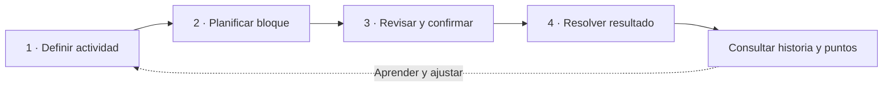
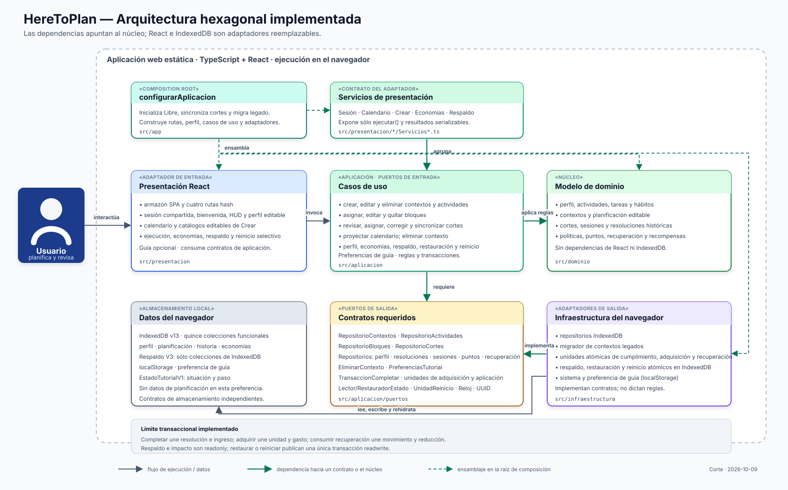

<div align="center">

<picture>
  <source media="(prefers-color-scheme: dark)" srcset="branding/banners/heretoplan-banner-oscuro.webp" />
  
</picture>

# HereToPlan

**Planificar con intención. Revisar lo hecho. Ajustar sin perder la historia.**

[](docs/02-funcionalidades.md)
[](docs/04-dominio-y-persistencia-local.md)
[](LICENSING.md)

[**Abrir aplicación**](https://nicocg32.github.io/HereToPlan/) · [**Cómo usarla**](docs/Guia-uso.md) · [**Documentación**](docs/README.md) · [**Arquitectura**](docs/01-arquitectura-general.md)

</div>

---

## Por qué existe

Empecé HereToPlan durante unas vacaciones, después de mis estudios. Quería hacer un calendario propio que me ayudara a organizar mis actividades y hábitos, con un sistema de recompensas que me motivara a cumplir metas.

Mientras lo desarrollaba me interesó una distinción que una lista de tareas no siempre hace: **qué quiero hacer, cuándo pienso hacerlo, qué tiempo me comprometo a dedicarle y qué ocurrió realmente**. De ahí nacieron las reglas de compromisos, puntos y recuperación.

No doy por comprobado que esas reglas mejoren la productividad. Esa es precisamente la hipótesis que quiero **evaluar mediante el uso**.

## Qué puedes hacer hoy

| Espacio        | Funciones disponibles                                                                      |
| -------------- | ------------------------------------------------------------------------------------------ |
| **Calendario** | Organizar bloques, revisar cortes, confirmar compromisos y resolver resultados.            |
| **Crear**      | Guardar tareas, proyectos y hábitos reutilizables; asignarlos después a fechas.            |
| **Puntos**     | Consultar saldo, recompensa Día libre, inventario y banco de recuperación.                 |
| **Respaldo**   | Exportar JSON, analizar un archivo, restaurar con confirmación o reiniciar selectivamente. |

El seguimiento puede ser manual o con cronómetro. **Medir tiempo no completa automáticamente un bloque.** La aplicación guarda la planificación en este navegador mediante IndexedDB; el perfil visible no es una cuenta remota.

<details>
<summary><strong>Ver el recorrido de una planificación</strong></summary>



Un bloque confirmado no se borra libremente. Las políticas estricta y flexible regulan qué cambios son admisibles; [conoce los estados](docs/10-estados-y-secuencias.md).

</details>

## Estado real del proyecto

| Estado            | Alcance comprobable en el repositorio                                                                                                        |
| ----------------- | -------------------------------------------------------------------------------------------------------------------------------------------- |
| **Implementado**  | Web local con actividades, planificación, cortes, cronómetro, puntos, Día libre, recuperación y respaldo JSON V3.                            |
| **En validación** | Comprensión del recorrido, utilidad de incentivos, continuidad de datos y pruebas de accesibilidad con personas y tecnologías de asistencia. |
| **Propuesto**     | Sincronización entre dispositivos, cuentas, calendarios externos, plantillas de agenda y editor completo de composición de tareas.           |

**No se promete** colaboración, sincronización ni acceso a los datos desde otro navegador por el solo hecho de abrir el mismo sitio. Los tests existentes evalúan reglas y recorridos técnicos; no reemplazan la [evaluación de uso sostenido](docs/Validacion-producto.md).

## Cómo está construido

| Pieza            | Tecnología o responsabilidad                                                     |
| ---------------- | -------------------------------------------------------------------------------- |
| **Interfaz**     | React 19, TypeScript, React Router y Vite.                                       |
| **Reglas**       | Dominio separado de la interfaz; casos de uso, puertos y adaptadores.            |
| **Persistencia** | IndexedDB v13 con **15 colecciones**; localStorage para preferencias de la guía. |
| **Respaldo**     | Archivo JSON V3, análisis antes de escribir y restauración transaccional.        |
| **Calidad**      | Vitest, Testing Library, axe-core, ESLint y verificaciones en GitHub Actions.    |
| **Distribución** | GitHub Pages entrega solo archivos estáticos bajo `/HereToPlan/`.                |

<details>
<summary><strong>Explorar el diagrama de componentes</strong></summary>



[Arquitectura por niveles](docs/01-arquitectura-general.md) · [Modelo de dominio](docs/modelo-dominio.svg) · [Despliegue](docs/arquitectura-despliegue.svg)

</details>

## Ejecutarlo desde el código

Necesitas **Node.js 24.18.0 o superior dentro de la rama 24** y npm según el lockfile. [`.nvmrc`](.nvmrc) fija la versión utilizada en CI.

```bash
npm ci
npm run dev
```

Abre la dirección que muestre Vite. Para revisar los cambios:

```bash
npm run format:check
npm run lint
npm run verify:docs
npm run test
npm run build
```

La batería completa de CI también incluye accesibilidad, cobertura, revisión CSS y verificación del build de Pages. [Comandos y límites de validación](docs/09-instalacion-y-despliegue.md).

## Rutas de lectura

| Si quieres...               | Empieza aquí                                                                                                                                     |
| --------------------------- | ------------------------------------------------------------------------------------------------------------------------------------------------ |
| **Conocer la idea**         | [Origen y propuesta](docs/00-origen-y-propuesta.md) → [Guía de uso](docs/Guia-uso.md).                                                           |
| **Comprender el código**    | [Arquitectura](docs/01-arquitectura-general.md) → [Datos](docs/04-dominio-y-persistencia-local.md) → [Estados](docs/10-estados-y-secuencias.md). |
| **Continuar desarrollando** | [Método](docs/17-desarrollo-y-metodologia.md) → [Pruebas](docs/09-instalacion-y-despliegue.md) → [Validación](docs/Validacion-producto.md).      |

[**Explorar el índice completo**](docs/README.md) · [**Recursos visuales**](branding/README.md)

## Autoría, licencia y atribuciones

HereToPlan es un **proyecto personal independiente**. Su código y documentación originales, dentro de los derechos que pueda conceder su titular, se publican bajo [PolyForm Noncommercial 1.0.0](LICENSE). No es una licencia que conceda uso comercial general.

Consulta [LICENSING.md](LICENSING.md) y [NOTICE](NOTICE) para las condiciones vigentes. El [registro de licencias y recursos](docs/Licencias-y-recursos.md) distingue los avisos existentes de las atribuciones de dependencias y recursos que aún deben verificarse. **Este cambio documental no modifica permisos de reutilización.**
