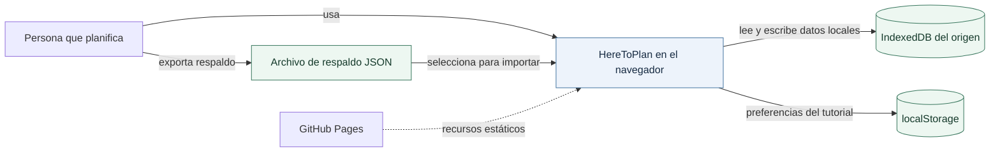
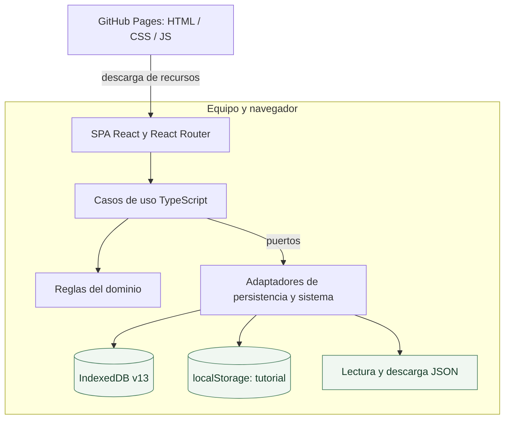
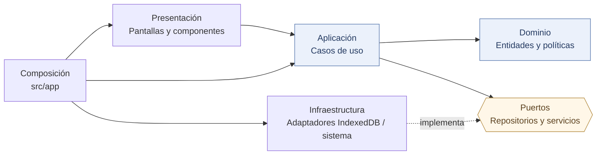
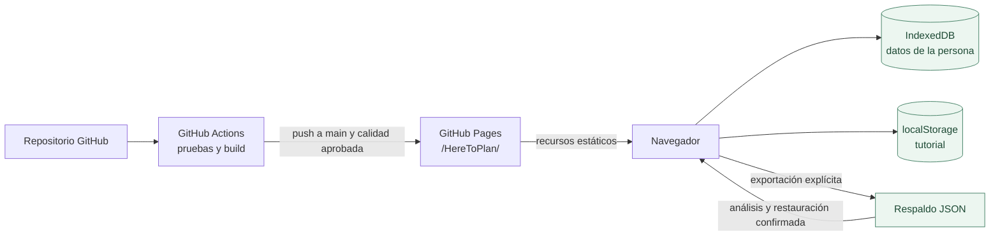

# 01 · Arquitectura: del contexto al código

HereToPlan es una **aplicación web estática con datos locales**, organizada con arquitectura hexagonal: dominio, casos de uso, puertos y adaptadores. Las reglas de negocio son independientes de React e IndexedDB; los adaptadores del navegador ejecutan las transacciones de persistencia.

## Nivel 1 · Contexto del sistema

GitHub Pages entrega el código y los recursos; las actividades, compromisos y saldos permanecen en el navegador de cada persona.

## Nivel 2 · Contenedores en ejecución

El navegador es a la vez interfaz y entorno de ejecución. No hay API de negocio alojada en un servidor ni autenticación remota en esta versión. Algunas preferencias de ayuda no se incluyen en el respaldo funcional.

## Nivel 3 · Componentes y dirección de dependencias

| Nivel           | Carpeta real                                     | Responsabilidad                                                 |
| --------------- | ------------------------------------------------ | --------------------------------------------------------------- |
| Dominio         | [`src/dominio/`](../src/dominio)                 | Invariantes, estados, fórmulas y reglas independientes de React |
| Aplicación      | [`src/aplicacion/`](../src/aplicacion)           | Coordinar operaciones y contratos de puertos                    |
| Infraestructura | [`src/infraestructura/`](../src/infraestructura) | IndexedDB, mapeadores, reloj, UUID, archivos y preferencias     |
| Presentación    | [`src/presentacion/`](../src/presentacion)       | Calendario, actividad, billetera, respaldo, tutorial y feedback |
| Composición     | [`src/app/`](../src/app)                         | Crear adaptadores reales e inyectarlos en casos de uso y vistas |

Consulta los contratos de cada componente en [Arquitectura](Arquitectura.md).

## Nivel 4 · Distribución y datos

**La publicación no traslada los datos entre navegadores u orígenes.** Cada navegador y perfil conserva su almacenamiento; dentro de ellos, cada origen tiene una base independiente. Para trasladar la planificación, exporta y restaura un respaldo.

## Principales fronteras de consistencia

- El catálogo de actividades existe aunque no se programe ningún bloque.
- El corte confirmado conserva instantáneas, aunque después cambie la definición de la actividad.
- Resolver un compromiso y acreditar puntos forman una operación atómica; reintentar no puede duplicar resultados.
- Comprar una recompensa y consumirla no son sinónimos.
- Restaurar un respaldo sustituye el estado funcional, por lo que la aplicación analiza antes de escribir y exige confirmación.

[Diagrama de componentes](arquitectura-componentes.svg) · [Arquitectura detallada](Arquitectura.md) · [Persistencia](04-dominio-y-persistencia-local.md) · [Despliegue](Despliegue.md)
