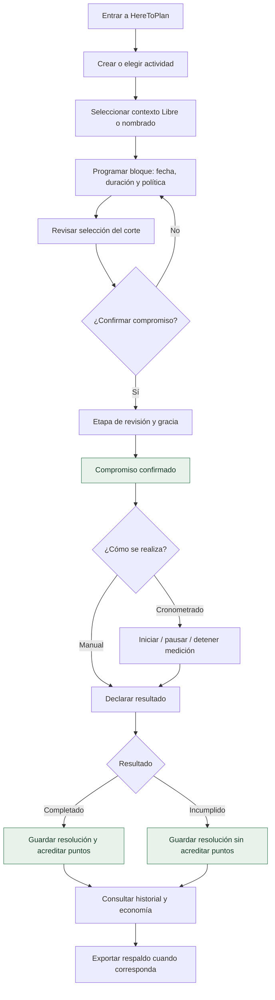

# 03 · Recorrido de uso

## Del catálogo a una planificación revisable

El cronómetro es opcional. Los estados del corte y sus condiciones de transición se detallan en [10 · Estados](10-estados-y-secuencias.md) y [Dominio](Dominio.md).

## Cuatro pantallas públicas

| Ruta hash      | Para qué se usa                                 |
| -------------- | ----------------------------------------------- |
| `#/calendario` | Planificar, consultar y resolver bloques        |
| `#/crear`      | Gestionar las definiciones de actividades       |
| `#/puntos`     | Revisar saldo, recompensas y recuperación       |
| `#/respaldo`   | Exportación, análisis y restauración / reinicio |

El nombre visible del perfil es local y no constituye una cuenta autenticada.

## Decisiones que merecen confirmación

- **Antes de confirmar:** revisar carga temporal y rigidez de los bloques elegidos.
- **Después de confirmar:** no borrar silenciosamente el compromiso; registrar su resolución o una modificación permitida.
- **Antes de restaurar:** leer el diagnóstico del archivo. `RESTAURAR` reemplaza las colecciones funcionales, no fusiona datos.
- **Antes de reiniciar:** revisar el impacto y conservar un respaldo; `REINICIAR` es una operación distinta, con elementos históricos preservados.

[Guía de uso paso a paso](Guia-uso.md) · [Respaldo](Respaldo.md)
