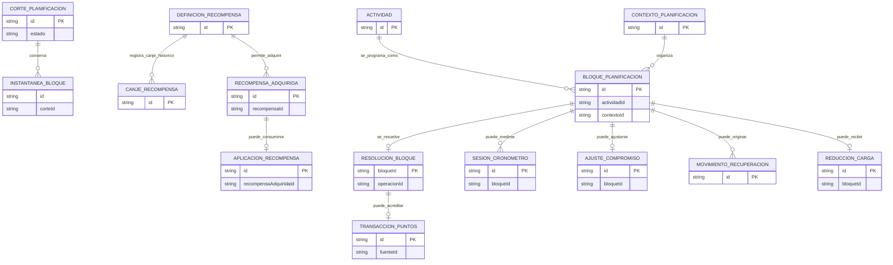
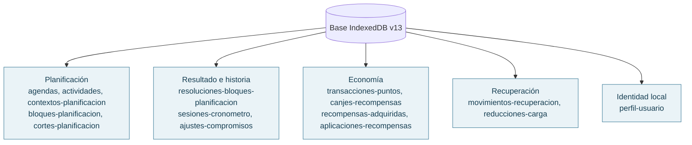

# 04 · Dominio y persistencia local

**IndexedDB** almacena registros en _object stores_ con claves e índices. La aplicación valida las relaciones entre identificadores y utiliza transacciones para mantener su consistencia.

## Entidades principales (vista conceptual)

Las relaciones son conceptuales: IndexedDB no impone claves foráneas. `INSTANTANEA_BLOQUE` está **embebida** en el corte y las definiciones de recompensas se configuran en código. Los canjes históricos y las unidades adquiridas se guardan por separado; la migración convierte cada canje antiguo en una unidad consumida.

## Modelo físico: object stores IndexedDB (versión 13)

Son **15 almacenes**. Las colecciones se respaldan mediante un contrato JSON V3. `localStorage` guarda una preferencia del tutorial que **no forma parte de las 15 colecciones**.

## Correspondencia de operaciones y almacenes

| Operación                     | Lecturas/escrituras que importan                                           |
| ----------------------------- | -------------------------------------------------------------------------- |
| Crear y programar             | Actividades, contextos, bloques; sin comprometer hasta el corte            |
| Confirmar                     | Cortes con instantánea y estado; historia independiente del catálogo       |
| Completar con puntos          | Resolución de bloque + ingreso de puntos en una transacción                |
| Adquirir / aplicar recompensa | Egreso de puntos, unidad adquirida y aplicación; sin doble consumo         |
| Cronometrar                   | Sesión vinculada y operaciones idempotentes                                |
| Recuperar                     | Movimientos y reducciones, ligados a reglas de cálculo                     |
| Restaurar                     | Vaciar y reponer las 15 colecciones en una sola transacción, tras análisis |

**Índices reales relevantes:** `por-operacion-id` en resoluciones y sesiones; `por-fuente-semantica` en movimientos de puntos; `por-bloque-id` en varios registros; estos ayudan a impedir duplicados de operación según el adaptador.

## Versiones de almacenamiento y respaldo

- **Base local:** `VERSION_BASE_DATOS = 13`, en [`esquemaBaseDatos.ts`](../src/infraestructura/persistencia/indexeddb/esquemaBaseDatos.ts).
- **Formato exportado:** `versionFormato = 3`, independiente de la base interna.
- **Registros:** actividades V2; otros mapeadores V1, con compatibilidad según el contrato de respaldo.

[Contrato del dominio](Dominio.md) · [Contrato del respaldo](Respaldo.md) · [Estados](10-estados-y-secuencias.md)
