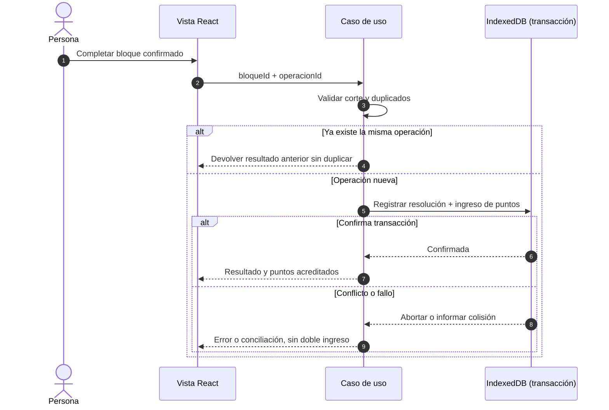

# 05 · Reglas que sostienen el producto

Las **reglas y operaciones del dominio** determinan el comportamiento de HereToPlan y pueden probarse independientemente de la interfaz.

## Compromiso y trazabilidad

- Una `Actividad` puede existir sin fecha ni bloque.
- El bloque se programa con minutos, contexto, fecha y política; un corte confirmado guarda una instantánea del compromiso.
- `ESTRICTO` y `FLEXIBLE` tienen permisos distintos; los ajustes permitidos se fijan mediante políticas. No puede ampliarse desde la aplicación un plazo externo cuya autoridad no le pertenece.
- Un bloque confirmado se resuelve explícitamente; el cronómetro solo registra tiempo.

## Puntos: fórmula inicial del código

En [`FormulaPuntosBloque.ts`](../src/dominio/puntos/FormulaPuntosBloque.ts) la configuración inicial es **30 minutos por punto** y **máximo 4 puntos por bloque**. Para minutos planificados positivos:

$$
P(m)=\min\left(4,\left\lceil\frac{m}{30}\right\rceil\right)
$$

| Minutos del bloque | Puntos al completarlo |
| -----------------: | --------------------: |
|                 15 |                     1 |
|                 30 |                     1 |
|                 31 |                     2 |
|                 90 |                     3 |
|                150 |                     4 |

La fórmula usa **minutos planificados**, no minutos medidos por el cronómetro; no representa una métrica objetiva de esfuerzo, salud o productividad. Un incumplimiento no recibe este ingreso.

## Atomicidad e idempotencia

El contrato del adaptador es tan importante como la fórmula: **resolver y acreditar deben confirmarse juntos**. Otras operaciones sensibles, como canjear/aplicar recompensas o restaurar, también utilizan unidades transaccionales específicas.

## Recompensas, descanso y recuperación

- Adquirir una unidad de recompensa implica descontar puntos; su estado inicial es `DISPONIBLE`.
- Aplicarla puede pasarla a `CONSUMIDA`, sujeto a restricciones. La vista previa no aplica cambios.
- `Día libre` es una recompensa implementada cuyo efecto depende de elegibilidad y política.
- La recuperación utiliza minutos excedentes y topes diarios/semanales; su cálculo no concede recuperación sin límite.

## Garantías y advertencias

Los tests prueban casos específicos del contrato, no la utilidad de la política. El modelo no debe inducir a trabajar más para maximizar puntos ni convertir la recuperación en una sanción. Antes de modificar una fórmula o un estado, se deben revisar la persistencia, las migraciones, los respaldos y las pruebas existentes.

[Contrato del dominio](Dominio.md) · [Operaciones y adaptadores](Arquitectura.md) · [Pruebas](17-desarrollo-y-metodologia.md)
