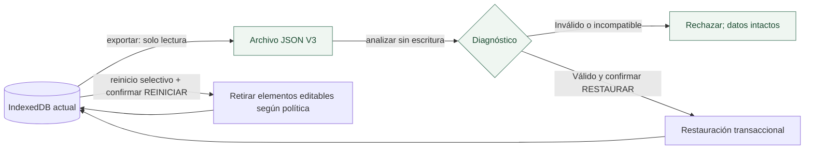

# 08 · Respaldo, restauración y reinicio

La salida portátil más importante de HereToPlan es un **respaldo JSON del estado funcional local**. No es un informe automático de productividad ni una copia sincronizada en la nube.

## Exportar, analizar, restaurar y reiniciar

**Exportar** genera un archivo sin cambiar la base. **Analizar** informa compatibilidad y cantidades sin escribir. **Restaurar** reemplaza las quince colecciones en una transacción después de una confirmación explícita. **Reiniciar** no importa archivos: aplica una política selectiva sobre el estado actual y conserva determinados hechos históricos.

## Versionado y alcance

- Formato exportado actual `HereToPlan.respaldo`, `versionFormato: 3`.
- Compatibilidad documentada de importación V1, V2 y V3 mediante rutas de migración definidas.
- Las 15 colecciones están en [04 · Datos](04-dominio-y-persistencia-local.md) y en el contrato [Respaldo](Respaldo.md).
- La preferencia del tutorial en `localStorage` no se incluye en el respaldo funcional.
- El JSON no está cifrado por defecto: quien conserve el archivo debe protegerlo y revisar qué información contiene.

[Guía práctica](Guia-uso.md) · [Contrato detallado V3](Respaldo.md) · [Estados y secuencia](10-estados-y-secuencias.md)
