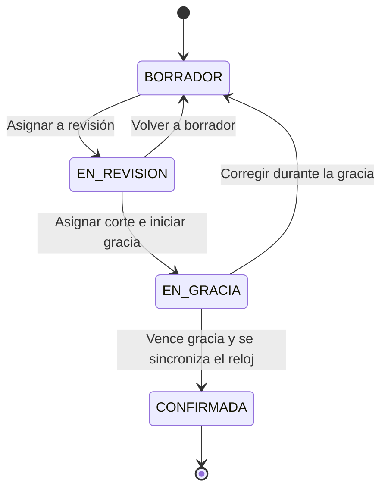
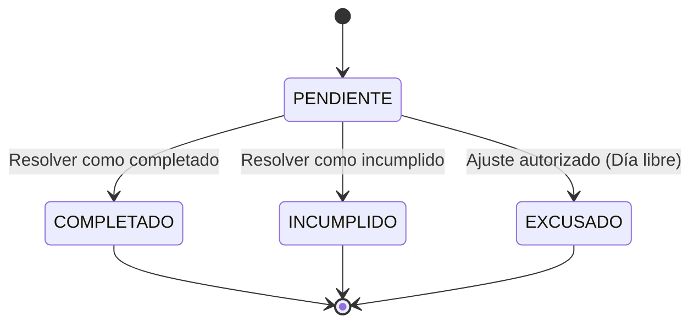
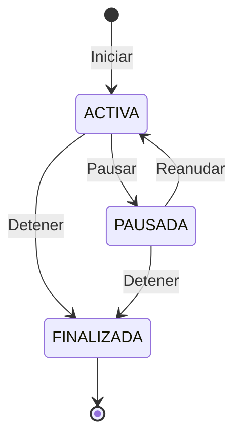
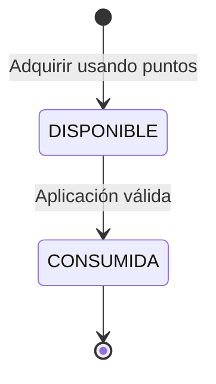
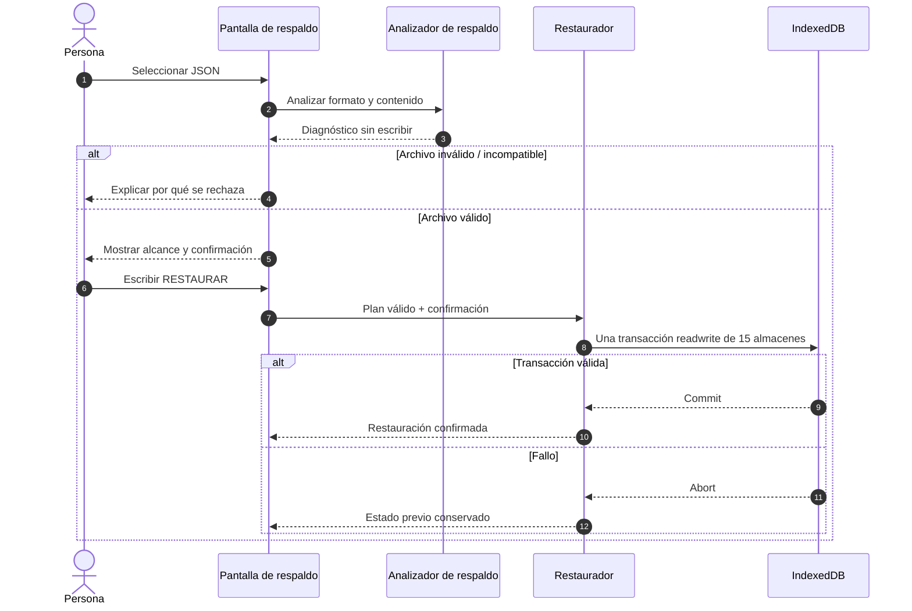

# 10 · Estados y secuencias

El modelo posee varias máquinas de estado distintas; mezclarlas en un único diagrama ocultaría restricciones. Estos diagramas describen transiciones conceptuales verificadas contra los tipos y casos de uso, sin reemplazar las validaciones del código.

## 1. Corte de planificación

El código define `DURACION_GRACIA_MINUTOS = 10`. La confirmación automática depende de los tiempos y acciones del caso de uso, no de una máquina que se ejecute por sí sola sin sincronización. El estado `CONFIRMADA` protege la instantánea histórica. Consulta [CortePlanificacion.ts](../src/dominio/planificacion/CortePlanificacion.ts).

## 2. Resultado de un bloque

`COMPLETADO` y `INCUMPLIDO` son resultados del contrato `ResolucionBloquePlanificacion`; `EXCUSADO` es un resultado permitido por la mecánica de recompensa, no una acreditación por trabajo realizado.

## 3. Cronómetro

Las sesiones conservan operaciones de inicio, pausa, reanudación y detención, con identificadores para evitar reintentos duplicados. Una sesión `FINALIZADA` no completa por sí sola el compromiso. [Fuente](../src/dominio/cronometro/SesionCronometro.ts).

## 4. Unidad de recompensa adquirida

La consulta del catálogo, la compra y la aplicación son pasos diferentes. No se permite consumir la misma unidad dos veces. [Fuente](../src/dominio/recompensas/RecompensaAdquirida.ts).

## 5. Respaldo: secuencia de restauración

El archivo se trata como entrada no confiable. La preferencia del tutorial permanece fuera de esta restauración. [Contrato y migraciones](Respaldo.md).

## 6. Referencia complementaria: agenda heredada

`Agenda` también posee estados propios `BORRADOR`, `CONFIRMADA` y `FINALIZADA`, pero no debe confundirse con `CortePlanificacion`, cuyo contrato `EN_REVISION`/`EN_GRACIA` se utiliza en el calendario actual. Ver [Agenda.ts](../src/dominio/agendas/Agenda.ts) y [tipos](../src/dominio/agendas/tipos.ts).
