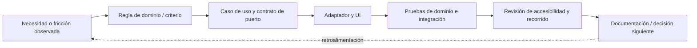

# 17 · Desarrollo y metodología

## Organización del desarrollo

El sistema separa reglas de dominio, casos de uso, puertos, adaptadores e interfaz. El desarrollo se centra en un ciclo completo de planificación: preparar, confirmar, ejecutar y revisar. Las pruebas comprueban que se conserva la historia, los reintentos no duplican operaciones y los datos pueden recuperarse.

GitHub Actions ejecuta las comprobaciones de formato, análisis estático, accesibilidad, cobertura y compilación. Los cambios que superan estos controles en `main` se publican en GitHub Pages.

## Ciclo de trabajo

## Cómo comprobar un cambio

1. Leer el contrato afectado: [Dominio](Dominio.md), [Arquitectura](Arquitectura.md) o [Respaldo](Respaldo.md).
2. Modificar la capa que corresponde sin saltarse puertos por comodidad.
3. Añadir pruebas para caso válido, error relevante y reintento / reapertura si cambia persistencia.
4. Ejecutar formato, lint, pruebas, build y verificaciones de Pages/documentación.
5. Actualizar el diagrama correspondiente y registrar las limitaciones que permanezcan.

## Validación técnica y de producto

Las pruebas automatizadas comprueban reglas y recorridos concretos. La revisión con axe detecta problemas de accesibilidad en los estados evaluados y el workflow comprueba la publicación. El [protocolo de uso sostenido](Protocolo-uso-sostenido.md) complementa esos controles con observaciones sobre claridad y utilidad cotidiana.

## Prioridad actual

La fase actual se centra en comprender las reglas durante el uso cotidiano y comprobar la continuidad de los datos. Las observaciones guiarán los ajustes antes de ampliar el catálogo de recompensas o incorporar sincronización.

[Origen y motivación](16-motivacion-y-contexto.md) · [Próximos pasos](15-escalabilidad-y-nuevos-mercados.md) · [Validación de uso](Validacion-producto.md)
